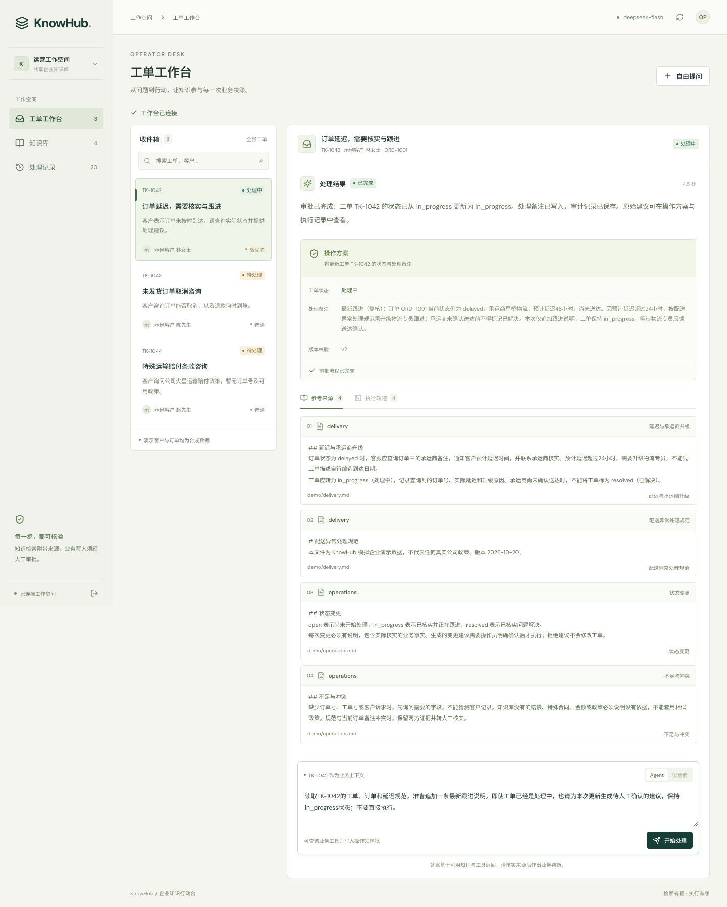

# KnowHub

**企业知识检索与工单处理引擎 · Knowledge into accountable action.**

让内部客服从处理规范、当前订单和工单事实出发，形成有依据的处理建议；经操作员确认后，再写回工单。2025 年 PDF 问答原型在本分支升级为可运行的业务 Agent。



## 一条可检查的业务流程

以模拟工单 TK-1042 为例：

1. 读取工单，取得关联订单 ORD-1001。
2. 用业务工具查到 `delayed`、预计延迟48小时、尚未送达。
3. 检索配送规范，找到“延迟超过24小时升级物流专员”的原文。
4. 生成 `in_progress` 状态与跟进备注的**待确认建议**。
5. 操作员批准后，以事务、行锁、版本校验写入工单和审计；拒绝不写入。
6. 重复批准返回同一结果，不重复更新版本或插入审计。

这里的客户、订单、SOP和承运商均为**明确标注的模拟数据**，没有真实客户部署或退款执行。业务 API 与数据库查询、向量推理、模型调用、确认事务均实际运行。

## 实现

| 层 | 技术与职责 |
| --- | --- |
| 工作台 | React / TypeScript / Vite，工单、知识上传、回答、来源、工具轨迹、审批、服务端历史 |
| 服务 | Python 3.12 / FastAPI，单工作区 Bearer 令牌，上传与调用限制 |
| 知识 | PDF / Markdown / TXT，页码和章节；multilingual-e5-small，384维归一化向量 |
| 检索 | PostgreSQL / pgvector 精确余弦检索；BM25；RRF 融合，保留原文与来源 |
| Agent | LangGraph 状态图 + DeepSeek 原生 Function Calling；每次最多4轮模型、12次工具调用 |
| 数据 | PostgreSQL 文档、订单、工单、运行快照、事务审计 |
| MCP | stdio 只读知识、工单与订单工具，复用实际实现 |
| 交付 | Docker PostgreSQL、CPU运行镜像、锁定依赖、GitHub Actions测试与构建 |

RRF 是检索融合排序，本项目没有将其写成 cross-encoder Rerank；没有实现 GraphRAG，也不把框架调用包装成自主学习或模型训练。

```mermaid
flowchart LR
  UI[操作员工作台] --> API[FastAPI]
  API --> G[LangGraph 模型与工具循环]
  G --> LLM[DeepSeek Function Calling]
  G --> R[BM25 + 向量 / RRF]
  G --> B[工单与订单只读工具]
  R --> PG[(PostgreSQL + pgvector)]
  B --> PG
  G --> P[暂存修改建议]
  P --> UI
  UI --> C[明确批准或拒绝]
  C --> TX[事务 / 版本校验 / 幂等审计]
  TX --> PG
```

## 本地启动

需要 Python3.12、[uv](https://docs.astral.sh/uv/)、Node22+、Docker，以及一个有 Function Calling 能力的模型服务。本机验证使用 DeepSeek；兼容其他 Chat Completions 服务的边界还没有逐个验证。

```bash
git clone https://github.com/lemon5227/KnowHub.git
cd KnowHub
git switch feature/enterprise-workflow
uv sync --locked --python 3.12
docker compose -p knowhub up -d db
cp .env.example .env
```

在被忽略的 `.env` 中设置随机 `KNOWHUB_API_TOKEN`（至少24字符），以及 `KNOWHUB_CREDENTIAL_FILE` 指向自己的私有模型配置文件。也可通过 `KNOWHUB_MODEL_API_KEY` 环境变量提供密钥。不要把真实密钥写入示例、前端或Git。

支持的私有JSON字段为 `base_url`、`model_name`、`api_key`；也可读取已存在的 `model.cloud_api` 嵌套结构。环境中的模型名和地址可覆盖文件配置。项目不会修改或复制凭证文件。

```bash
cd frontend
npm ci
npm run build
cd ..
uv run uvicorn knowhub.api:build_app --factory --host 127.0.0.1 --port 8077
```

访问 [本地工作台](http://127.0.0.1:8077)，输入 `.env` 中的操作员令牌。首次启动会下载多语言向量模型，并导入模拟业务记录和 `examples/knowledge/` 的SOP。种子导入是幂等的，不重置已处理工单。向量模型默认在CPU运行。

开发前端可在另一终端运行 `npm run dev --prefix frontend`，地址 [localhost:5177](http://127.0.0.1:5177)，代理到8077。

本地模型调用另有每进程默认40次的请求上限，可用 `KNOWHUB_SESSION_MODEL_LIMIT` 调整。每次请求最多1200 completion tokens。耗尽时明确失败；不会自动无限重试。按供应商实际计费，项目不声称免费调用。

### CPU 容器镜像

```bash
docker build -t knowhub:workflow .
```

镜像只包含应用、合成样例和构建后的UI，不包含 `.env`、本地数据库、原始测试PDF或模型密钥。Linux明确选择CPU版PyTorch。运行时需要加入 `knowhub_default` 网络，将数据库地址改为 `db:5432`，传入环境变量，并把凭证文件只读挂载后用容器路径覆盖 `KNOWHUB_CREDENTIAL_FILE`。使用 `--user "$(id -u):$(id -g)"` 可保持私有文件的原有读取权限，无需放宽凭证权限。模型缓存可通过独立挂载复用。

## 接口与 MCP

[API合同](docs/api-contract.md)列出精确类型、输入与返回值。除健康检查外，所有API均需Bearer授权。服务为一个共享授权工作区；不宣称多租户、部门级ACL或互联网部署安全边界。

只读MCP：

```bash
uv run python -m knowhub.mcp_server
```

它通过本地stdio提供 `knowledge_search`、`ticket_lookup`、`order_lookup`，不提供任何写工具。MCP客户端配置工作目录与相同数据库环境；本机进程授权由操作系统和MCP宿主负责。

## 验证与已知边界

```bash
# 一次性创建独立测试库；此命令不重置演示库
docker compose -p knowhub exec -T db createdb -U knowhub knowhub_test
uv run pytest -q
uv run ruff check knowhub tests scripts
npm test --prefix frontend
npm run build --prefix frontend
# 应用运行时执行，消耗实际模型额度
uv run python -m scripts.evaluate
```

测试仅清理明确命名的 `knowhub_test` 库。CI不调用付费模型；测试中的固定模型输出用于验证真正的图、工具与数据库边界，不能当作真实模型效果。实际模型、向量和浏览器验收另有[验证报告](docs/verification-2026-10-20.md)与[原始输出](artifacts/evaluation/)。

- 当前语料很小，dense使用精确扫描，BM25在内存计算；未做大规模并发与生产容量验收。
- 原文引用编号可核验，但这不自动证明每个生成结论都被证据支持；需要人工抽检。保留了一次引用校验失败与一次业务文字误解。
- 上传同一来源会原子替换其片段。这不是增量图索引，也不宣称OCR、复杂表格或扫描PDF处理。
- Agent有调用上限，但选择工具和澄清问题仍有模型差异。缺少政策或编号时应追问或说明不足。
- 只暂存和修改工单状态/备注，不自动退款、取消订单、通知客户或操作真实外部系统。
- 服务中断后可以查看已保存运行；未完成运行暂不支持从中间步骤自动续跑，需重新请求。审批支持重载后继续操作。

## 仓库结构

`knowhub/`为新引擎，`frontend/`为操作台，`examples/`为合成数据，`scripts/`为实际能力检查，`tests/`为回归，`artifacts/`为可公开验证证据。

旧 `backend/` 保留2025年原型以便对照。其依赖和原始Chroma文件不用于新引擎；新项目测试只收集 `tests/`，不会加载旧原型的过时示例。
